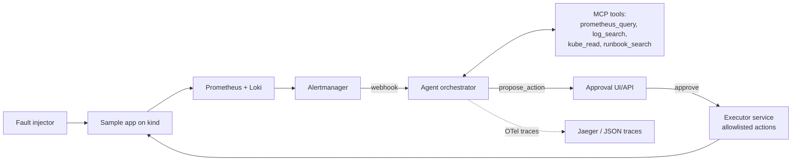

# incident-agent

An on-call incident triage agent: it receives Prometheus/Alertmanager alerts from a local Kubernetes cluster, investigates using read-only tools (PromQL, log search, kubectl, runbooks), and outputs a root-cause hypothesis with linked evidence plus a proposed remediation. Any write action requires explicit human approval and runs through a separate executor service. Entirely free and open source — local LLM via Ollama, local kind cluster, no paid APIs or cloud.

> **Status: Phase 0 (scaffold) complete.** Cluster/eval phases are not yet implemented — see `docs/DECISIONS.md` for what's done and what's pending. This section will be replaced with a real measured result from `evals/report.md` once Phase 7 runs.

## Why

On-call engineers spend the first several minutes of every incident doing the same mechanical investigation: check the alert, look at a dashboard, grep some logs, check recent deploys. This project builds an agent that automates that first pass — producing a hypothesis with evidence a human can verify in seconds, not minutes — while keeping every write action behind explicit human approval and infrastructure-enforced (not prompt-enforced) read-only access for the investigation itself.

## Quickstart

Prerequisites (all free):

```bash
brew install --cask docker   # launch it once after installing
brew install kind kubectl helm uv
brew install ollama          # or https://ollama.com/download
```

Check what's missing and get actionable fixes:

```bash
make preflight
```

Bring up the cluster, observability stack, and sample app:

```bash
make up
```

Run fault injection scenarios, start the approval UI, or run the eval harness:

```bash
make faults
make ui
make eval
```

## Architecture



Safety is enforced by infrastructure, not prompts: the agent's `kube_read` tool uses a Kubernetes ServiceAccount with read-only RBAC. Write actions exist only in a separate executor service behind an approval API with an allowlist and an append-only audit log.

See `docs/customer-deployment.md` for deployment/permissions details and `docs/failure-modes.md` for known limitations.
